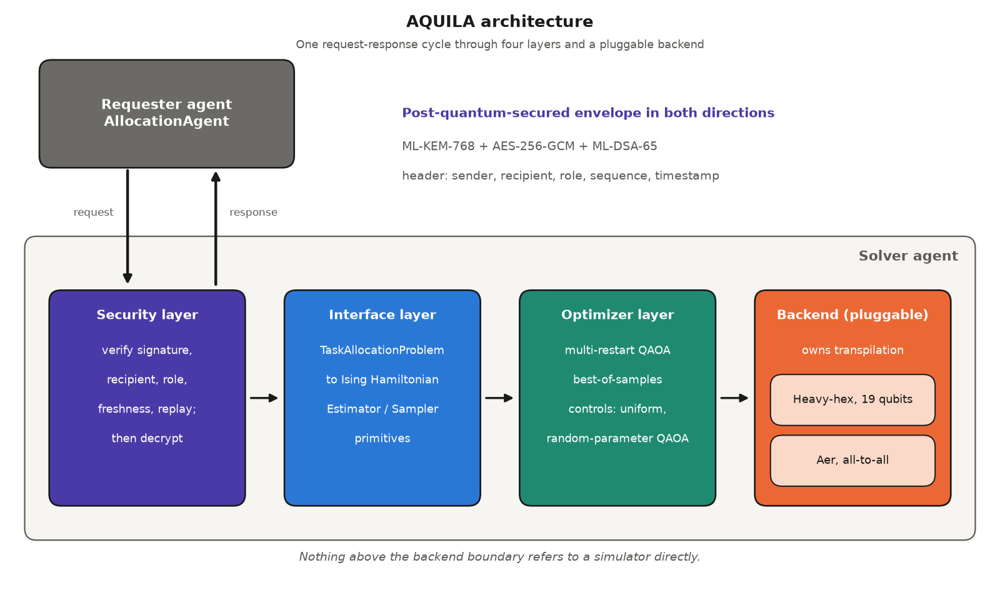
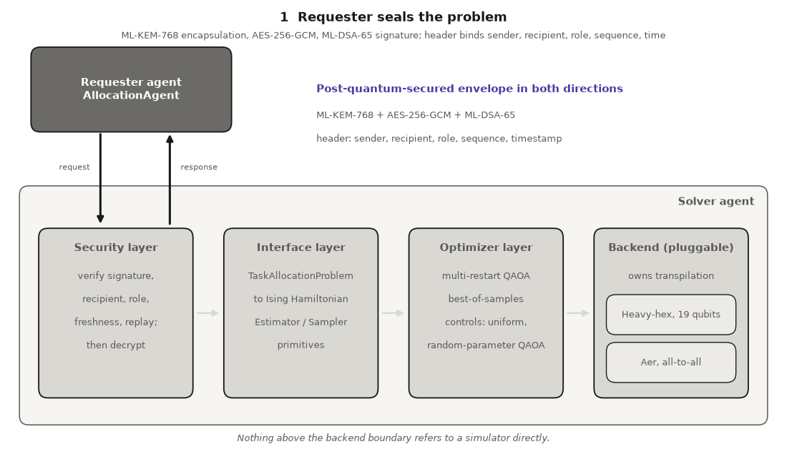

# AQUILA

[](https://github.com/sunilgentyala/AQUILA/actions/workflows/ci.yaml)
[](https://www.python.org/)
[](LICENSE)
[](https://github.com/sunilgentyala/AQUILA/releases)

**Agentic QUantum Interface for Load Allocation.**

AQUILA lets an agentic AI system offload combinatorial subtasks, such as task and resource allocation across compute clusters, to a QAOA solver through a backend-agnostic quantum-classical interface, hardened with a post-quantum-secured (ML-KEM-768 / ML-DSA-65) agent messaging layer.


---

## Architecture



One request-response cycle, step by step:



The interface layer talks to backends purely through Qiskit's `EstimatorV2`/`SamplerV2` primitive protocol. Nothing above that boundary refers to the simulator directly, so a hardware-backed primitive implementation would satisfy the interface without changes to the optimizer or agent code.

## Results summary

Revised evaluation (v0.2): 30 random instances per size and weight family, sizes 6-14, instance seeds drawn independently of optimizer seeds. Every method is scored against an exact optimum (verified by two independent exact solvers) and reported as exact-optimum success rate with Wilson 95% intervals. All sampling methods get the same budget (3 restarts x 1,024 shots = 3,072 samples).

Exact-optimum success rate, real-valued weights in [1, 20]:

| n | QAOA | QAOA (random params) | Uniform sampling | SA (tuned) | Karmarkar-Karp | Greedy LPT |
|---|---|---|---|---|---|---|
| 8 | 1.00 | 1.00 | 1.00 | 0.87 | 0.33 | 0.10 |
| 10 | 0.97 | 0.93 | 1.00 | 0.57 | 0.13 | 0.03 |
| 12 | 0.70 | 0.70 | 0.73 | 0.17 | 0.10 | 0.00 |
| 14 | 0.33 | 0.33 | 0.43 | 0.07 | 0.07 | 0.00 |

**Honest reading.** QAOA is statistically indistinguishable from uniform random sampling at the same sample budget (paired exact McNemar tests, all p >= 0.58), and from the same circuit with random, unoptimized parameters. At these sizes the best-of-samples step does the work, not the quantum optimization. Exact solvers (enumeration, subset-sum DP) are faster than QAOA by two to three orders of magnitude. The interface, the controls and the evaluation harness are the contribution; no QAOA advantage is claimed.

**Change notes (v0.2).** Earlier versions of this README reported a mean approximation ratio `C_opt / C_found` and described classical baselines as collapsing. With real-valued weights the optimal cost is often near zero, so that ratio drops toward zero for any method that is not exact; it overstated the gap, and results are now reported as exact-optimum success rates. Earlier versions also stated 4,096 sampling shots when the sampler ran 1,024, and described RSA-3072/ECDSA-P256 as matched-strength to ML-KEM-768/ML-DSA-65 (they are not; the PQC sets are NIST category 3). All three are fixed here.

**Security layer (v0.2).** Envelopes now sign and authenticate sender, recipient, message role, sequence number and timestamp, with receiver-side replay and freshness protection. A 512-byte payload becomes a 5,007-byte envelope (1,088-byte KEM ciphertext, 3,309-byte signature, 98 bytes of header, nonce and tag). Timing comparisons against 128-bit and 192-bit classical baselines are in [`evaluation/results/security_overhead_v2.csv`](evaluation/results/security_overhead_v2.csv).

**Backend portability.** A second backend (`HeavyHexBackend`: heavy-hex lattice, {rz, sx, x, cx} basis) runs the same optimizer unchanged and returned identical best costs on all tested instances. Routing costs about 3x the depth and 2x the two-qubit gates (n = 14: depth 177 vs 57, 546 vs 273 two-qubit gates). All execution is still on simulators.

Full data, scripts and figures: [`evaluation/`](evaluation/) and [`evaluation/results/`](evaluation/results/).

## Install

```bash
pip install -e ".[dev]"
```

Requires Python 3.12+. Core dependencies: `qiskit`, `qiskit-aer`, `pqcrypto`, `cryptography`.

## Usage

```bash
python examples/demo_end_to_end.py   # full request -> QAOA solve -> secured response cycle
pytest tests/                         # 40 tests covering all four layers
python evaluation/quality_controls.py # reproduce the controlled quality sweep (--instances 30)
python evaluation/make_plots.py       # regenerate figures from evaluation/results/*.csv
```

## Citation

If you use the AQUILA software, please cite it using the metadata in [`CITATION.cff`](CITATION.cff)
(GitHub's "Cite this repository" button reads it).

---

## Author

**Sunil Gentyala** — IEEE Senior Member
Lead Cybersecurity and AI Security Consultant, HCLTech, Dallas, TX, USA
sunil.gentyala@ieee.org

[](https://www.linkedin.com/in/sunil-gentyala/)
[](https://github.com/sunilgentyala)

---

## License

Apache-2.0 — see [LICENSE](LICENSE).
